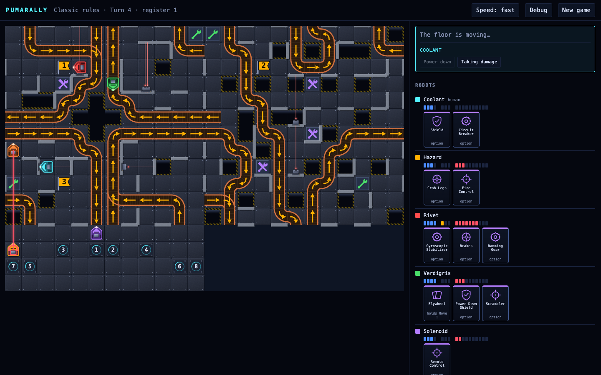
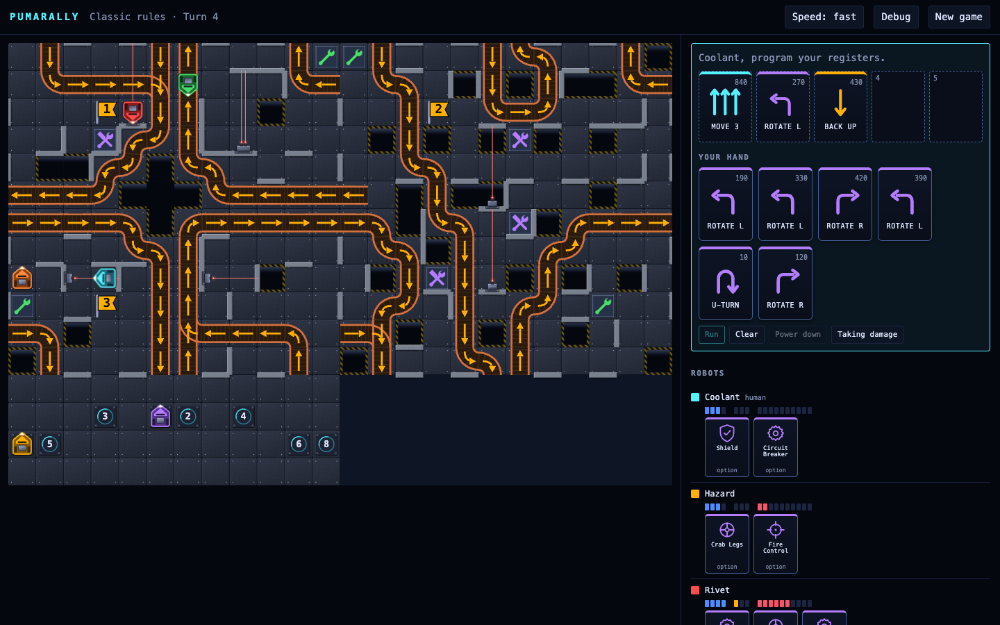
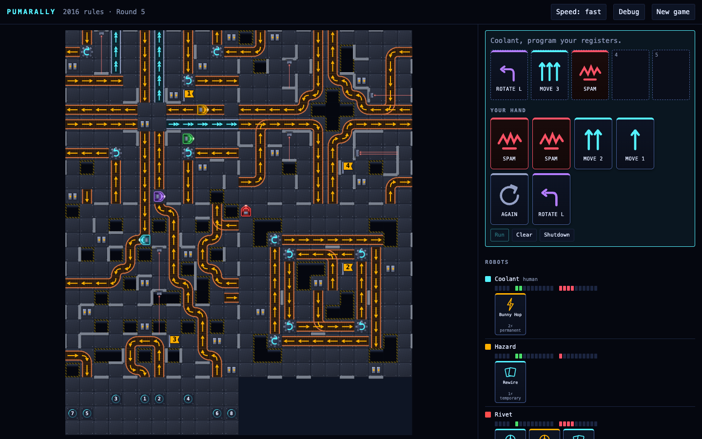
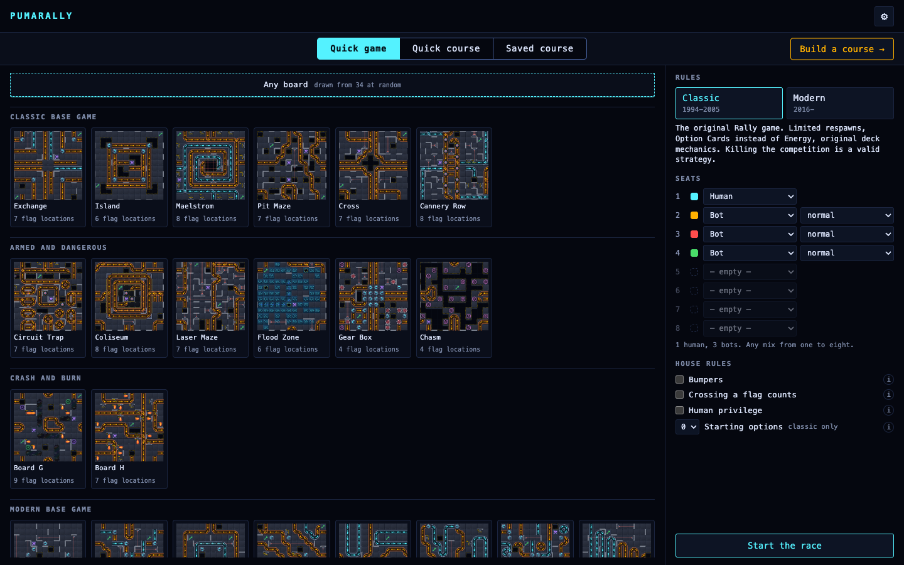

# PumaRally

**Program five registers, hand control to the factory floor, and hope you
guessed right.** A faithful port of the RoboRally rules, drawn in original
vector art, with the boards transcribed from photographs of the printed ones.

Inspired by *RoboRally* (Richard Garfield, Wizards of the Coast). Rules and
board layouts are reimplemented as functional data; the name, artwork and
printed boards remain theirs. Nothing here is scanned: the tiles are original
drawings and the layouts are hand-transcribed tile data.

## Play

<https://greykit.com/games/pumarally/>

No install. Vanilla ES modules, no build step, no dependencies, and no network
at play time beyond fetching the boards.



*Classic rules, turn 4, register 1. Six robots on Crosscut (Cross and Pit
Maze over the docking bay): a laser fires up the left edge, the three flags
are out on the floor, and each robot's option cards, lives and damage are on
the right.*

| | |
|---|---|
|  |  |
| *Programming, classic: four registers filled, three cards left in the hand. The next card goes in by click, drag or its number key.* | *The same screen under the 2016 rules, on Four Quarters: SPAM in the hand, energy and upgrades under each robot.* |



*Set-up. Boards are shelved by the box they came out of; pick one, or let the
game draw one, then fill up to eight seats with people and bots.*

> **Status: rebuilt, and playable under the classic and 2016 rules.** The game was
> rebuilt from the ground up on 2026-09-15 on the board workshop's
> foundation, after the first version stopped being fixable; `PLAN.md` says
> why and how, `EDITOR-REVIEW.md` records what the workshop needed first, and
> the tag `classic-monolith` holds the old game. What plays today is the
> classic game and the 2016 game, chosen at set-up: any mix of one to eight
> human and bot seats, fifty-two transcribed boards from the classic and 2016
> boxes (thirty-four of them on the quick-game shelf: a random facing, three
> flags drawn from where it marks), three multi-board courses, hot seat,
> autosave.

## What works today

| | |
|---|---|
| Board format, validator, renderer and workshop (`editor/`) | done |
| Classic rules engine: movement, pushing, conveyors, gears, pushers, presses, lasers, burners, damage and locking, destruction and return, power down, repair, checkpoints | done, 48 scenarios by name |
| Bots: distance fields and beam search, three skill levels | done |
| Headless simulation with conservation laws, on every course, mixed seats | done, in CI |
| The game on screen: set-up, draft, programming by click, keys and drag, animated floor, hot seat, autosave and resume | done |
| Option cards: all twenty-seven of the two printings, with their questions, the two-wrench site, the hand limit, the loss on destruction and the option exchange | done, 51 scenarios by name; the AMIGO eleven carry their German text and the reading each needed |
| Oil, portals, swing doors, unnumbered presses, burners on the way through, lives by game size (Crash and Burn, from the AMIGO book) | done, 29 scenarios by name |
| Fire under either book: a flame jet and a flamer stand in for each other, each resolved on its own edition's timing | done, 3 scenarios by name; a declared substitute, ours not the books' |
| The 2016 expansions' floor: water, drains, ledges and ramps, currents, randomizers, teleporters, flamers (from the three Factory Floor Guides) | done, 11 scenarios by name |
| The 2016 rules: own decks, Priority Token, SPAM and Haywire, Energy, the upgrade shop with all forty cards' effects, shutdown, reboot, the reference card's floor order | done, 76 scenarios by name; two declared substitutes (reboot point, first priority) |
| Flag locations marked on the boards, for the engine to choose among | done |
| One-way walls (Radioactive, and its 2016 reprint Contamination) | done, 5 scenarios by name; the rule is from the Ultimate RoboRally Collection, a fan compilation, as no publisher's rulebook is in the archive |
| Trap doors (Grand Prix; Turn & Burn; the 30th Anniversary boards) | done, 7 scenarios by name; a pit in the registers printed on it, opening at the END of the register -- the author's reading, so a robot may cross it or step off it in the register it opens |
| Repulsor fields (Grand Prix; Turn & Burn; the 30th Anniversary boards) | done, 8 scenarios by name; a springy wall, always on and from both sides (the author's ruling): a robot's own card throws it back as far as the card moves, a pushed robot goes back as far as its pusher's card, and a belt or a pusher meets a plain wall (ours) |
| Chop shops (Grand Prix; Turn & Burn; the 30th Anniversary boards) | marked and drawn so the boards can be transcribed; no effect in play yet, by the author's decision, until the Armed and Dangerous ammunition cards its refill needs are built |
| Radiation and radioactive waste (Radioactive; Contamination) | done, 8 scenarios by name; classic rule from the same fan compilation, and the 2016 reading ours: the classic timing, a damage card for a point, and an Energy or a free upgrade for waste's option card |

## How it is put together

```
index.html            the game, at the repo root
game/                 the rebuilt game: engine, bots, simulation, screen
  README.md           the contract: step(state, answer) -> { state, events, waiting }
  engine/             pure rules over plain-JSON state and the workshop's boards
  ui/                 the screen, drawn from the pending request and nothing else
  data/               card tables lifted verbatim from the transcriptions
  tools/              check-all.js, sim.js, the scenario ledger and tests
editor/               the board and course workshop, and the data it writes
  data/               every board and course, as PRBoard and PRCourse JSON
  README.md           the format, the workshop, and what its first use found
screenshots/          the pictures in this file
icon.svg              the icon; og.png, the favicons and apple-touch-icon.png are rendered from it
PLAN.md               the rebuild plan and its milestones
EDITOR-REVIEW.md      the workshop review, findings ranked, and what remains
```

**One reader of a board.** The game assembles its course from the same
documents, through the same library, that the workshop draws and validates.
A board corrected in the workshop is corrected in every course and every
saved game that lays it.

**One way into the engine.** `step()` advances until it needs an answer and
returns one request with its legal answers enumerated. Whether a player may
press something is exactly whether that request is theirs. Bots answer the
same requests; the simulations seat bots and randomly-answered humans
together, so the path a person's clicks take is exercised by every simulated
game rather than by none.

## Playing

The new-game screen is two columns under a tab per way a course comes
about: **Quick game** (one board, picked or drawn, laid at a random facing
with three flags drawn from where it marks), **Quick course** (N boards and F
flags on sliders, all drawn and stacked as the box stacks them) and **Saved
course** (every shipped course and every one you saved). The left column is
a window onto the boards or courses the tab offers and scrolls on its own;
the right column holds the rules, eight seats (Human, Bot or empty), the
house rules, each explained behind its (i), and Start, and stays put. **Build
a course** beside the tabs opens the workshop, and the gear at the top right
holds the button that forgets everything. Any
board plays under either book: what the other box printed works as its own
book says (water slows, a swing door shuts, currents convey), and only the
markings the chosen book uses are shown -- wrenches under classic, batteries
under 2016. Each turn
you are dealt `9 − damage` cards; put five into your registers and press
Run. Then the five registers execute in order: every robot's card in
priority order, then the floor in the printed order.

| Key | |
|---|---|
| `1`–`9` | place that card in the next open register |
| `Backspace` | take the last card back |
| `Enter` | run the registers, or lift the hot-seat curtain |
| `y` / `n` | answer a power-down question |

A card's own question, a two-wrench site's offer and a choice of which card
to lose are asked on the panel as buttons; the held cards show under each
robot with the printed text on hover. **Starting options** in set-up deals
everyone up to three at the start, because the printed route hands one out
in about one game in fifty.

Drag a card onto a register to place it there instead. Set-up remembers your
seats and house rules; the game autosaves every step and resumes. **New game**
on the race screen goes back to set-up without throwing the race away: it
stays resumable until another race is started.

## Building courses

The **course workshop** (`editor/index.html#course`, or the Build a course
button on the new-game screen) lays boards out, puts the flags on, and saves to this browser's
library, where the set-up screen offers the result under Saved course. A race
needs eight starting squares: the docking bay board is the quick way to all
eight, or place them one square at a time anywhere on the floor (**B** in the
workshop). A board's flag marks are its suggestions and what Suggest picks
from; a flag you place yourself may stand on any floor square. The two blank
Master Builder boards, Blueprint and Tabula Rasa, are for building on: they
are in the workshop's palette and off the quick-game shelf. To ship a course as a default, **Download**
it from the workshop, drop the file into `editor/data/courses/`, and run
`node editor/tools/build-index.js`. See `editor/README.md`.

## Development

```bash
node tools/check-no-photos.js          # no reference photograph is tracked or staged
node tools/check-assets.js             # every file index.html points at exists
node editor/tools/check-imports.js     # ... and the rest of the workshop's checks, see editor/README.md
node game/tools/check-all.js           # the tables, the rule tests, the scenario ledger
node game/tools/sim.js 20              # twenty mixed games on every shipped course
```

All of these run in CI ahead of deploy.

**The reference photographs are checked, not just ignored.** `maps/`,
`manual*/` and `rules/` hold photographs of printed board art and rulebook
pages; this repo is public; `check-no-photos.js` runs first in CI against
the fresh clone and refuses any route by which they could ship.

**Merging wants the full 40-character SHA, through the API.** `glab mr merge`
does not work on this project; the API form does:

```bash
glab api --method PUT "projects/86391698/merge_requests/<N>/merge?sha=<full 40-char sha>"
```

## Other Puma games

[PumaTriage](https://greykit.com/games/pumatriage/) ·
[PumaSOC](https://greykit.com/games/pumasoc/) ·
[PumaSecure](https://greykit.com/games/pumasecure/) ·
[PumaTower](https://greykit.com/games/pumatower/) ·
[Retro Surfer '96](https://greykit.com/games/retrosurfer96/) ·
[more](https://greykit.com/games/)

## Credits

Game design and code by shandower, with AI assistance from Claude.
Original game by Richard Garfield. MIT licensed.
